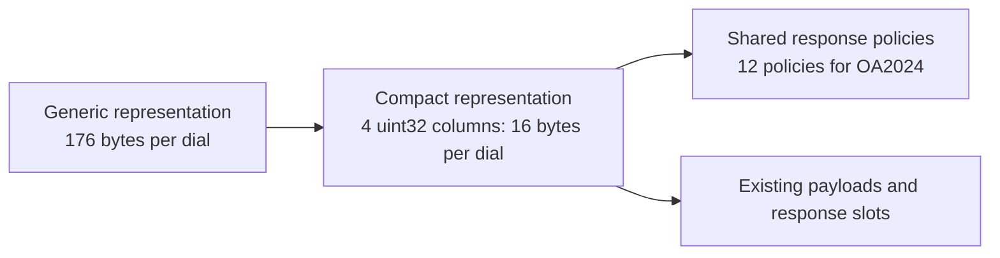
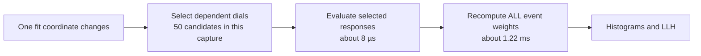

# CUDA standard-dial optimization: V100 results and next steps for Minuit2

**31 October 2026; updated 1 November 2026** — OA2024 production inputs. All calculations remain in `double` precision.

| Setting | Value |
|---|---|
| Configuration | `configOA2024.yaml` + `override/v13Prod.yaml` |
| GPU | Tesla V100-SXM2-32GB |
| Host threads | 4 |
| Model size | 2,406,926 events; 20,340,421 unique dials |
| Local benchmark coverage | 842 free fit coordinates in both eigen and no-eigen runs |
| Weight layout | `warpInterleaved` |

## Main result

Compact descriptors accelerate global dial-response evaluation by **2.50×** and approximately halve the time of a complete evaluation. Expensive local coordinates, including the FSI eigen coordinates, also benefit. The median local evaluation remains near **2.09 ms**, with event-weight recomputation as its dominant cost.

| Workload | Measured outcome | Next priority |
|---|---|---|
| Global parameter updates | About **2× faster** complete evaluations | Payload layout and specialized kernels |
| Expensive local FSI updates | About **10.9 → 6.0 ms** per evaluation | Account for the physical parameters changed by the eigen transformation |
| Median local updates | About **2.09 ms**, essentially unchanged | Recompute only affected events, when profitable |

This improvement is directly relevant to MCMC proposals that update all parameters. It does not establish a speedup for a complete MCMC run. The subsequent selective-event implementation with a structural selection cache reduces **mean local propagation time by 4.7–5.2% for single-coordinate workloads and 3.8% for the sampled two-coordinate stencils**. Narrow coordinates improve by more than 2×, while broad eigen updates retain dense execution. See the [selection-cache results](#selection-cache-results--1-november-2026) below; complete MIGRAD/HESSE speedups remain unmeasured.

## Measurement sets and methodology

| Measurement | Source | Scope | Purpose |
|---|---|---|---|
| Uninstrumented benchmark | [Benchmark report](../../benchmark-weights-compact-20261031-190025/report.md) | CPU and four CUDA variants; three trials after warmup | Measure application performance |
| Uninstrumented no-eigen benchmark | [No-eigen report](../../benchmark-weights-noEigen-20261031-203949/report.md) | CPU, reference cached CUDA, compact cached CUDA; three trials | Isolate physical-parameter updates |
| Nsight Compute capture | [NCU report](../../benchmark-weights-compact-20261031-195643/weights.ncu-rep) | NCU 2025.2.1; reference and compact, each with one local and one global call | Explain GPU behavior |
| Local-propagation prototype | [Local benchmark report](../../benchmark-weights-local-20261101-003328/report.md) | CPU, dense compact, coverage, sparse; local and derivative workloads | Validate selective event updates on production eigen coordinates |
| Cached local propagation | [Selection-cache benchmark report](../../benchmark-weights-local-cache-20261101-022640/report.md) | Same four cases; production eigen coordinates, individual event comparisons | Measure cached selections and cached dense-fallback decisions |
| Extracted hardware counters | [Metrics JSON](../../benchmark-weights-compact-20261031-195643/analysis/metrics.json) | Eight profiled kernel actions | Preserve the evidence used below |

The original compaction benchmark, no-eigen benchmark and NCU capture use the same GUNDAM module hash. The later local-propagation experiment uses a subsequent build; variants are compared within that run. Each run loads the inputs **once**, then switches backends while retaining the loaded model. Parameter points and random seeds are identical across variants within a benchmark; data selection and likelihood configuration are preserved.

These are reproducible propagation workloads, without minimization or Hesse. Configurations run sequentially, without randomized interleaving. Absolute timings from different jobs should not be compared directly.

## What changed in the backend

Standard dials previously used a generic **176-byte descriptor** on the GPU. That descriptor also contains fields intended for programs, composites, and external weights.

The CUDA option `compactDials: true` introduces four `uint32` columns:

| Column | Contents |
|---|---|
| Input reference | Index of the dial input |
| Payload offset | Start of the dial's coefficient data |
| Payload size | Number of payload elements |
| Policy reference | Index of a shared response policy |

A policy groups the dial type, input count, extrapolation setting, response bounds, and smoothing settings. OA2024 needs only **12 shared policies**. Policies are grouped by their binary values, preserving signed zeros in particular.



| GPU descriptor storage | Reference | Compact | Change |
|---|---:|---:|---:|
| Bytes | 3,579,914,096 | 325,448,848 | **−90.9%** |
| Decimal size | 3.58 GB | 325 MB | About **3.25 GB freed** |

These figures describe allocated storage, not memory traffic per propagation.

| Property | Behavior |
|---|---|
| Payload values and layout | Preserved |
| Response indices and dependencies | Preserved |
| Multiplication order within each event | Preserved |
| Dense and sparse response evaluation | Same numerical routines as the reference |
| Transformed-input cache | Retained |
| Production default | Compact packing requested automatically; generic fallback when unsupported or unprofitable |

Compact mode falls back to the generic representation for models containing formulas, composites, surfaces, or external producers. It also falls back if indices exceed 32 bits or policy sharing would not reduce storage. Diagnostics report the actual path; the benchmark rejects a case named `compact` if compact representation is inactive.

This iteration changes descriptors. It does not yet transpose spline coefficients or specialize kernels by dial family.

## Performance measured without NCU

Median evaluation times in milliseconds:

| Mode and scenario | Reference | Compact | Speedup |
|---|---:|---:|---:|
| Cached, constant | 0.533 | 0.536 | Comparable |
| Cached, local1 | 2.089 | 2.091 | Comparable |
| Cached, local2 | 2.085 | 2.091 | Comparable |
| Cached, global | 14.427 | 7.070 | **2.04×** |
| Recompute, global | 13.961 | 6.818 | **2.05×** |

The cached/global breakdown isolates the effect of the change:

| Stage | Reference | Compact |
|---|---:|---:|
| Dial responses | 12.251 ms | **4.905 ms** |
| Event weights | 1.255 ms | 1.255 ms |
| Histograms | 0.186 ms | 0.187 ms |
| Device LLH | 0.011 ms | 0.011 ms |

Dial-response time decreases by **60%**. The gain is much larger than the observed trial variation:

| Global evaluation median | Trial 1 | Trial 2 | Trial 3 |
|---|---:|---:|---:|
| Reference | 14.440 ms | 14.425 ms | 14.426 ms |
| Compact | 7.050 ms | 7.097 ms | 7.082 ms |

The small differences in local medians do not establish a regression. GPU stage intervals overlap the complete evaluation time and must not be added to host time.

## What NCU adds

Backend timers show **where time is spent**. NVIDIA Nsight Compute shows **how a kernel uses the GPU**.

| Question | Backend timers | NCU contribution |
|---|---|---|
| Which stage dominates? | Stage durations | Per-kernel analysis |
| Is memory traffic the main issue? | No direct measurement | DRAM bytes and throughput |
| Are reads using memory sectors effectively? | No direct measurement | Useful bytes per sector and cache hit rates |
| Does register pressure constrain execution? | No direct measurement | Registers per thread and occupancy limits |
| Are spills a likely cost? | No direct measurement | Local-memory load/store traffic |
| Did the optimization improve complete evaluations? | **Primary evidence** | Explains the change; complements the benchmark |

Before the change, timings alone could not distinguish costly interpolation, scattered memory reads, and register pressure. The initial capture directed the work toward data representation. The new capture tests that explanation.

### Dense responses: less traffic despite lower occupancy

Comparison of actions 2 and 6 in the same NCU report:

| Metric | Reference | Compact |
|---|---:|---:|
| Profiled kernel duration | 11.662 ms | 4.585 ms |
| DRAM reads | **8.182 GB** | **2.439 GB** |
| DRAM writes | 326.6 MB | 326.2 MB |
| Total DRAM throughput | 730 GB/s | 603 GB/s |
| DRAM throughput / reported peak | 81.3% | 67.2% |
| Useful bytes / 32-byte global-load sector | 6.73 | 9.15 |
| L2 hit rate | 26.8% | 38.3% |
| Registers per thread | 52 | 66 |
| Measured occupancy | 45.4% | 33.2% |
| Local-memory load/store traffic | Zero | Zero |

DRAM reads decrease by **70.2%**, while writes remain almost unchanged. Read-sector utilization improves but remains partial; this instruction-side ratio is not an exact measure of overall DRAM efficiency.

The compact kernel is faster **despite lower bandwidth in GB/s and lower occupancy**. Its main advantage is transferring much less data. Maximizing either utilization percentage in isolation would have missed that result.

Increasing register use from 52 to 66 reduces the register-limited resident blocks per SM from four to three, with 256-thread blocks. This is an additional target for future specialization. No local-memory traffic is measured, so spills are not the main observed cost.

Attributing every byte to a particular descriptor field or payload access would require further instruction-level analysis.

### Event weights: the remaining cost of local calls

Actions 1, 3, 5, and 7 produce similar measurements:

| Metric | Approximate value |
|---|---:|
| Kernel duration | 1.22 ms |
| DRAM reads | 0.94 GB |
| DRAM throughput | 783–786 GB/s |
| Throughput / reported peak | 88% |
| Registers per thread | 32 |
| Occupancy | 92% |

Descriptor compaction has barely changed this stage. The local capture selects coordinate 0 and only **50 candidate dials**. Selected-response evaluation costs about **8 µs**, but the next kernel still recomputes the weights of **every event**.



Sparse response selection does not yet imply sparse event selection.

### How to interpret the capture

| Capture setting or limitation | Consequence |
|---|---|
| `--replay-mode kernel` | NCU replays kernels to collect metrics |
| `--cache-control all` | Caches are flushed between replay passes |
| `--clock-control none` | Clocks are not locked by the profiler |
| CUDA intervals surrounding a capture | Include profiling effects; not normal propagation timings |
| One captured local coordinate | Does not cover all parameter families or expensive FSI eigen coordinates |
| Uninstrumented benchmark | Remains the reference for application speedups |

See the [NVIDIA guide to replay and reproducibility](https://docs.nvidia.com/nsight-compute/ProfilingGuide/) for details of these effects.

## Local updates: benefits already relevant to Minuit2

The overall local median hides much more expensive coordinates:

| Effective fit coordinate | Reference | Compact |
|---|---:|---:|
| FSI `#1_eigen` | 10.898 ms | **6.037 ms** |
| FSI `#0_eigen` | 10.877 ms | **5.983 ms** |
| `NucleonFSI_TotalGraph` | 6.452 ms | **3.592 ms** |
| `MaCCQEGraph` | 4.591 ms | **2.989 ms** |

In this configuration, the FSI eigendecomposition mixes the group's physical parameters: changing one eigen coordinate changes the whole group. The high cost is consistent with that broad scope; it does not by itself show that an individual FSI dial is more expensive to interpolate.

| Notion of locality | Meaning |
|---|---|
| Local in fit space | One or a few fit coordinates change |
| Local in physical-parameter space | One or a few physical parameters change |
| Local in dial space | Only a subset of dial responses depends on those changes |
| Local in event space | Only a subset of event weights depends on the affected responses |

These notions are not interchangeable. Candidate counts measure dials visited before transformed-input reuse, not necessarily interpolation operations actually performed.

Minuit2 combines local evaluations, including finite differences, with moves along directions that may change multiple coordinates. Their frequency must be measured in a representative fit before converting these results into a complete-fit speedup. Likewise, the global scenario represents global MCMC proposals; other MCMC proposals may update individual parameters or blocks.

### Complementary experiment without eigendecomposition

The OA2024 inputs already contain `override/noEigen.yaml`. Applied after `override/v13Prod.yaml`, it disables eigendecomposition for every group using `name: "*"`. Applying this override was checked with `ConfigBuilder`, without loading the engine: all six groups have eigendecomposition disabled.

| Experiment | What it measures |
|---|---|
| Production configuration with eigen enabled | Cost of effective fit-coordinate updates, including group-wide physical changes |
| Configuration with eigen disabled | Cost of individual physical-parameter updates |
| Reference versus compact within either run | Effect of descriptor compaction for the same parameter sequence |

The complementary run used CPU, reference cached CUDA, and compact cached CUDA, with constant/local1/global scenarios. Reproduction command:

```bash
sbatch --export=ALL "$GUNDAM_REPO/tests/benchmarks/236CudaWeightBenchmark.sbatch" \
  --mode benchmark --work-dir "$OA_WORK" --config configOA2024.yaml \
  --override override/v13Prod.yaml override/noEigen.yaml \
  --python-module-dir "$GUNDAM_MODULE" \
  --cases CPU CUDA-cachedResponses-interleaved CUDA-cachedResponses-interleaved-compact \
  --scenarios constant local1 global \
  --output "$OA_WORK/benchmark-weights-noEigen-$(date +%Y%m%d-%H%M%S)"
```

This experiment ranks individual physical-parameter updates and helps compare their response cost with eigen-coordinate updates. The production eigen configuration remains the reference for the production workload.

Random points, and potentially active coordinates or effective bounds, differ between the two bases. Compare reference and compact within each run; equal LLH values are not expected between different physical parameter sequences.

This experiment does not yet measure affected-event coverage. A single physical parameter can still influence a large fraction of events, so coverage instrumentation remains necessary before choosing a sparse event path.

### No-eigen benchmark results

The [no-eigen benchmark](../../benchmark-weights-noEigen-20261031-203949/report.md)
is complete. Its resolved configuration confirms that eigendecomposition is
disabled for all six parameter groups. All three cases run in one process with
one dataset load. The model still contains 2,406,926 events and 20,340,421 unique
dials; compact mode is active with the same 12 policies and 325,448,848 descriptor
bytes. The parameter manifest contains 842 physical fit coordinates, with no
`_eigen` coordinates.

Median times from this run:

| Scenario or stage | Reference cached CUDA | Compact cached CUDA | Interpretation |
|---|---:|---:|---|
| Constant evaluation | 0.521 ms | 0.525 ms | Similar fixed cost |
| Local1 evaluation | 2.037 ms | 1.987 ms | **1.025×** total speedup; small compared with global gain |
| Local1 dial responses | 0.0103 ms | 0.0102 ms | Response evaluation is already inexpensive at the median |
| Local1 event weights | 1.252 ms | 1.252 ms | Dominant remaining local stage |
| Local1 histograms | 0.185 ms | 0.187 ms | Unchanged reduction path |
| Global evaluation | 14.373 ms | 6.909 ms | **2.08×** total speedup |
| Global dial responses | 12.248 ms | 4.882 ms | **2.51×** response speedup |

The local evaluation medians are stable across trials: reference
2.038 / 2.035 / 2.039 ms; compact 1.987 / 1.986 / 1.988 ms. The approximately
0.050 ms local improvement is visible in this run, but the measured response
and event-weight stage medians barely change. It should not be presented as a
large interpolation gain for the typical local call. Stage medians are not
additive, and timing the remaining host/synchronization work would require a
separate breakdown.

#### Physical locality versus eigen-coordinate locality

The following comparison describes the scope of the updates in two different
coordinate bases. It is not a paired comparison at identical physical points.

| FSI update | Candidate dials | Reference evaluation | Compact evaluation |
|---|---:|---:|---:|
| Eigen-coordinate updates in the production run | 2,778,807 per coordinate | About 10.9 ms | About 6.0 ms |
| Physical `PionFSI_QELowMomProbGraph` | 788,171 | 4.165 ms | 2.887 ms |
| Physical `PionFSI_AbsProbGraph` | 783,879 | 4.181 ms | 2.885 ms |
| Physical `PionFSI_QEHighMomProbGraph` | 444,239 | 3.542 ms | 2.718 ms |
| Physical `PionFSI_InelProbGraph` | 441,400 | 3.417 ms | 2.663 ms |
| Physical `PionFSI_CExLowMomProbGraph` | 321,118 | 3.152 ms | 2.577 ms |
| Physical `PionFSI_CExHighMomProbGraph` | 430,169 | 3.262 ms | 2.564 ms |

This supports the explanation that the production FSI eigen-coordinate cost
comes from changing the group together. It is not evidence of unusually slow
individual FSI interpolation. Compaction also helps the physical FSI updates,
although their total speedup is smaller because the event-weight cost remains.

Other physical coordinates are still expensive. For example,
`NucleonFSI_TotalGraph` selects 1,951,419 candidate dials and takes
6.493 → 3.505 ms; `MaCCQEGraph` selects 1,099,271 and takes 4.510 → 2.844 ms.
Disabling eigen does not make every physical update narrow.

#### Most coordinates select very few responses

Distribution across the 842 no-eigen coordinates, using each coordinate's
median candidate count over the trials:

| Candidate dials selected | Coordinates | Share |
|---|---:|---:|
| 0 | 50 | 5.9% |
| 1 | 641 | 76.1% |
| 2–32 | 9 | 1.1% |
| 33–1,000 | 20 | 2.4% |
| 1,001–100,000 | 76 | 9.0% |
| More than 100,000 | 46 | 5.5% |

**82.1% of coordinates select at most one response candidate.** This is a
coordinate-count distribution, not the frequency distribution of calls in a
Minuit2 fit. A shared response can affect many events, so it does not establish
event coverage or a guaranteed sparse-event speedup. Zero candidates likewise
describe response selection, not necessarily a zero total likelihood change.

The median candidate count falls from 571 in the production eigen run to 1 in
the no-eigen run. Nevertheless, the event-weight kernel remains around 1.25 ms.
The corresponding production and no-eigen local evaluation medians are
2.091 and 1.987 ms for compact CUDA. Since the parameter bases and sampled
points differ between runs, this is a workload comparison, not a recommendation
to disable eigen to speed up a complete fit.

CPU/CUDA comparisons pass within the no-eigen run, with maximum absolute LLH
difference `1.82e-12` and histogram/error difference `1.02e-11`. Individual
OA2024 event weights were not materialized for comparison. This run contains no
new NCU capture; hardware-counter conclusions above come from the earlier
production capture.

## Recommended next project: selective event propagation

For local updates, I would prioritize this work over another general payload transposition. Event weights account for about **60% of the 2.09 ms production median local evaluation**, and **63% of the 1.987 ms no-eigen median**. Their kernel already approaches peak memory bandwidth; avoiding unnecessary reads is a more direct target than increasing occupancy further.

| Phase | Change | Evidence required before proceeding |
|---|---|---|
| 1. Measure coverage | Count unique affected events per coordinate | Coverage distribution, selection cost, index memory |
| 2. Update selected events | Recompute complete products only for affected events | Individual weights agree with dense/CPU paths; local evaluation gets faster |
| 3. Select histogram bins | Optionally recompute only affected bins | Stable sums/errors and measurable additional benefit |
| 4. Validate fit workloads | Replay Minuit2 sequences, then run comparable fits | End-to-end benefit for the production workload |

### 1. Measure event coverage per coordinate

Extend the resident benchmark with the following measurements. Index construction must remain outside evaluation timers, while selection cost must be measured.

| Measurement | Purpose |
|---|---|
| Selected physical parameters and dials | Describe the scope after coordinate transformations |
| Unique dependent events and fraction of the model | Determine whether selective event updates can help |
| Affected groups of 32 consecutive events | Estimate a sparse path that preserves the `warpInterleaved` access pattern |
| Reverse-index storage | Quantify the memory cost |
| Event selection and recomputation time | Account for the overhead of the sparse path |

Few dials may still affect almost every event, for example through widely shared normalizations. The 50 candidates in the capture therefore do not prove that partial event recomputation would be profitable for that coordinate. Measure coverage before choosing the index structure and dense/sparse threshold.

### 2. Recompute products only for affected events

Build reverse dependencies from parameters/dials to events when activating the backend. With `warpInterleaved`, compare selecting individual events with selecting complete affected groups of 32 consecutive events. The latter deliberately recomputes some unchanged neighbors but preserves coalesced index reads; the best choice depends on coverage and measured traffic. For a local update, form a deduplicated event selection, recompute each selected event's complete product, and retain other weights in GPU memory.

| Requirement | Reason |
|---|---|
| Preserve multiplication order | Avoid unnecessary numerical differences |
| Preserve base weights and the reweight cap | Retain existing event-weight semantics |
| Handle zero and negative values | Keep all supported products valid |
| Recompute full selected-event products | Avoid fragile `new response / old response` updates and their rounding history |
| Retain a dense path | Avoid sparse-selection overhead when coverage is broad |

A first implementation may conservatively select a superset from physical dependencies, even when some transformed inputs eventually remain unchanged. Extra work can be measured; missing an affected event would be a correctness error.

| Situation | Initial policy |
|---|---|
| Low affected-event fraction and inexpensive selection | Candidate for sparse recomputation |
| Broad coverage, expensive selection, or excessive index storage | Dense recomputation |
| Observable migration, dynamic binning, external producers, or invalidated state | Explicit handling; prefer dense fallback in the first version |

### 3. Initially retain full histogram and LLH evaluation

After updating selected weights, initially rerun the complete histogram reduction from the weight buffer. This isolates the gain on the dominant stage and retains the current reduction.

A later step can select affected bins and recompute their sums and sums of squares using the existing reduction order. Atomic delta updates would raise additional questions about determinism and accumulated rounding. Device LLH costs only about **11 µs**, so partial LLH evaluation would have low priority.

### 4. Validate with sequences representative of Minuit2

| Validation workload | Purpose |
|---|---|
| Constant/local1/local2/global | Retain current reproducible comparisons |
| Finite-difference center/plus/minus and returns to center | Exercise local updates and cache reuse |
| Alternating coordinates | Check dependency selection across updates |
| FSI eigen coordinates | Cover group-wide physical changes |
| Multidimensional moves | Cover nonlocal optimizer steps |
| Replay of an actual Minuit2 coordinate trace | Measure a representative call distribution without repeated input loading |
| Comparable complete fits | Establish application-level improvement |

Compare individual weights, histograms, errors, and LLH against dense and CPU paths, including recovery after errors and invalidation. Measure index construction time and storage as well.

| Local evaluation budget | Time |
|---|---:|
| Production eigen median | About 2.09 ms |
| No-eigen median | About 1.987 ms |
| Event-weight stage in either workload | About 1.25 ms |
| Ideal remainder, production eigen | About 0.84 ms |
| Ideal remainder, no-eigen | About 0.735 ms |

The ideal remainders are budget bounds, **not predictions**. Selection and remaining event recomputation will have a cost. Global normalizations may retain a cost close to the dense path.

### Concrete next deliverable

The next implementation should first add an **event-coverage diagnostic to
benchmark 236**, without changing propagation results. For each physical or
eigen coordinate, report affected event count, affected 32-event group count,
index memory, and selection time. Keep index construction outside evaluation
timers and keep the one-load, hot-backend-switch workflow.

| Observation | First implementation to test |
|---|---|
| Few affected events and few affected 32-event groups | Recompute only selected event groups, retaining all other device weights |
| Few affected events but scattered groups | Compare event selection against group selection; measure lost coalescing |
| Broad event coverage | Retain the dense event-weight kernel |
| Zero response candidates and no other prediction invalidation | Retain existing prediction reuse |

Then compare the new sparse/group path against the current dense path, keeping
full histogram and device LLH evaluation for the first experiment. Evaluate
both production-eigen and no-eigen configurations, rather than choosing the
parameter basis with the most favorable benchmark result. A selection threshold
must follow measured cost; no fixed coverage percentage has been established.

This is a more targeted next step for Minuit2 than further reducing the
approximately 10 µs median response stage. The sparse path's performance remains
to be demonstrated; the coverage diagnostic is what determines where to use it.

## Further optimization of global updates

| Candidate | Target |
|---|---|
| Payload transposition | Improve coefficient reads across neighboring threads |
| Specialized `UniformSpline` kernels | Exploit the dominant spline representation |
| Specialized two-point `Graph` kernels | Exploit the dominant graph shape |
| Lower register pressure | Recover occupancy where useful |

`UniformSpline` and `Graph` together account for about **86% of OA2024 dials**. These directions remain useful for global proposals and expensive FSI coordinates.

For small local calls, the new capture supports a different priority: measure event coverage, then avoid recomputing unchanged event weights. Combining dense and sparse paths should serve MCMC and Minuit2 workloads better than assuming one kernel is optimal for every update.

## Validation status and limits

| Item | Status |
|---|---|
| CPU/CUDA comparisons for all four production benchmark configurations | Passed |
| CPU/CUDA comparisons for both no-eigen CUDA configurations | Passed |
| All six groups confirmed without eigendecomposition | Verified in the no-eigen resolved configuration |
| No-eigen maximum absolute LLH difference | `1.82e-12` |
| No-eigen maximum absolute histogram/error difference | `1.02e-11` |
| Maximum absolute LLH difference | `1.88e-12` |
| Maximum absolute histogram/error difference | `1.32e-11` |
| Individual OA2024 event weights | Not materialized in the original compaction run; compared successfully in both later local-propagation runs |
| Individual weights on small dedicated models | Compared by dedicated tests |
| CUDA propagation and surface tests on V100 | Passed, including compact propagation and error paths |
| ROOT test-runner and host-callback `NaN` fixes | Separate from descriptor compaction |
| Production default changed | Yes, after the selection-cache benchmark: compact descriptors and cached selective event groups |
| Complete-fit speedup measured | No |
| Selective event propagation | Cached version passes V100 comparisons and improves sampled local means by 3.8–5.2%; aggregate medians remain almost unchanged |

Both descriptor compaction and cached selective event propagation now have V100 benchmark evidence. Their gains apply to the measured propagation workloads; complete optimizer timings and Hessian accuracy remain to be validated.


## Prepared follow-up: resident local-update benchmark

Event-group propagation and coverage diagnostics are available in
benchmark 236. See the [run instructions and counter definitions](CudaWeightBenchmark.md#selective-event-updates-for-migradhesse-workloads).

| Variant | Purpose |
|---|---|
| Compact + dense weights | Performance baseline |
| Compact + exact coverage | Measure affected events/groups without changing weight execution |
| Compact + sparse groups | Test selective weight updates with dense fallback |

The prototype retains full histogram and LLH evaluation, ordered event products,
and the current error/rebuild invalidation rules. The initial 25% group threshold
is experimental. New one- and two-coordinate stencil scenarios exercise returns
to the center and bounded coordinates. They approximate derivative propagation
patterns; they do not establish MIGRAD/HESSE wall-time gains or validate Hessian
accuracy. After the successful selection-cache run, compact packing and cached
selective event groups become the production defaults; coverage remains a diagnostic.

Both the initial production-eigen run and the subsequent selection-cache run are available below.


## Production eigen local-update results — 1 November 2026

The [local benchmark](../../benchmark-weights-local-20261101-003328/report.md)
is complete. All CPU/CUDA comparisons pass, including final individual event
weights and exact bin membership. It uses one dataset load and three trials per
scenario. The following results describe the first sparse prototype, before the
selection cache described below.

### Correctness passes; aggregate performance regresses

| Scenario | Dense compact median | Sparse median | Change |
|---|---:|---:|---:|
| Constant | 0.541 ms | 0.543 ms | Similar |
| Local1 | 2.019 ms | 2.293 ms | **13.6% slower** |
| One-coordinate derivative stencil | 2.020 ms | 2.292 ms | **13.5% slower** |
| Two-coordinate derivative stencil | 2.018 ms | 2.292 ms | **13.6% slower** |
| Global | 6.885 ms | 6.905 ms | About 0.3% slower |

The mean evaluation time is also worse: 2.068 → 2.161 ms for derivative1 and
2.083 → 2.208 ms for derivative2. The narrow-coordinate gains therefore do not
compensate for the selection overhead across these sampled production workloads.
These are propagation sequences, not measured complete MIGRAD/HESSE timings.
The current sparse mode should **not replace the dense default** on these results.

| Validation or construction metric | Result |
|---|---:|
| Maximum absolute LLH difference | `1.88e-12` |
| Maximum absolute histogram/error difference | `1.32e-11` |
| Maximum absolute final event-weight difference | `1.39e-15` |
| Stored event index | 45,644,696 bytes, about 43.5 MiB |
| Event-index construction | About 1.1–1.7 s per indexed backend activation |

### Why the eigen workload defeats most sparse selections

The exact coverage case shows the following local-coordinate structure:

| Parameter group | Coordinates | Median affected events | Median affected groups of 32 | Coordinates using sparse execution |
|---|---:|---:|---:|---:|
| Flux | 100 | 2,395,205 | 74,874 | 0 |
| Detector variations, eigen | 571 | **2,406,926: all events** | **75,217: all groups** | 0 |
| Detector splines | 79 | 11,302 | 4,868 | 55 |
| FSI eigen | 6 | 925,607 | 74,787 | 0 |
| Cross-section | 82 | 46,495.5 | 26,776.5 | 30 |
| Binned cross-section | 4 | 156,413.5 | 25,053.5 | 2 |

Counts summarize the local1 coordinate-cost records; they are not the frequency
of those coordinates in a real optimizer. In total, **87 of 842 coordinates**
use sparse execution in this run. The detector eigen group alone accounts for
571 of 842 coordinates, explaining the aggregate median.

The FSI example also demonstrates spatial amplification: about 38.5% of events
are affected, but they occupy about **99.4% of the groups**. Selecting complete
warps offers little benefit there, even though the event fraction is below 50%.

| Cost for a typical broad detector-eigen update | Measured median |
|---|---:|
| Dense event-weight kernel | 1.250 ms |
| Exact coverage diagnostic | About 1.188 ms host selection |
| Sparse selection before early dense fallback | About **0.268 ms** host selection |
| Event-weight kernel after fallback | Still **1.250 ms** |

The sparse path repeatedly proves that the same broad update needs dense
execution. It pays the selection cost without avoiding the dense kernel.
This explains the regression; correctness of the cached weights is not the issue.

### Narrow coordinates do benefit

| Effective coordinate | Affected events | Groups | Dense evaluation | Sparse evaluation |
|---|---:|---:|---:|---:|
| Detector `ECalPID_muon_DSEcal` | 4,738 | 4,559 | 2.001 ms | **0.982 ms** |
| Binned cross-section `EB_bin_O_nubar` | 33,055 | 6,545 | 2.007 ms | **0.964 ms** |

These observations support retaining the selective kernel for narrow updates,
while improving the decision path for broad eigen updates.

### Prepared correction: cache structural selections and dense decisions

The next version adds a bounded cache of **eight exact changed-parameter
signatures**. Each signature records which physical parameters differ from the
previous successful propagation, together with the selection threshold.

| Cached item | Purpose |
|---|---|
| Complete sorted group selection and affected-event count | Reuse selection for repeated narrow dependency sets |
| Early dense-fallback decision | Avoid repeated scans for broad eigen updates |
| Exact parameter-change bitset | Avoid confusing distinct dependency sets; no approximate hashing |
| Threshold in the key | Keep decisions valid when the selection limit differs |

The cache is bound to an immutable model index and cleared on rebinding/model
replacement. Parameter values and event products are not cached under this key:
the dependency topology alone determines the selection. Each selected event still
recomputes its full ordered product using current responses. The union-builder's
scratch masks remain separate from cached results to avoid stale-mask errors.

The new `eventSelectionCacheHit` counter and existing selection timings will show
whether repeated MIGRAD/HESSE-style updates avoid the measured 0.268 ms cost.
Host tests cover different numerical values with the same dependency signature,
eviction, thresholds, dense decisions, sparse unions and rebinding. The C++ CUDA
host branch has been syntax-checked. **V100 results are now available in the
following section.**

The follow-up production-eigen matrix is now complete, with dense compact as
the performance reference.
If broad eigen updates remain dominant after eliminating selection overhead,
further gains will require reducing the cost of the dense event-weight path or
exploiting additional structure in shared normalization responses; event skipping
cannot remove a genuine dependency on almost every event.

## Selection-cache results — 1 November 2026

The [cached local benchmark](../../benchmark-weights-local-cache-20261101-022640/report.md)
is complete. All four cases share PID `673004`: inputs are loaded once and
backends are replaced in the resident engine. Production eigendecompositions
remain enabled. Three trials cover all 842 coordinates, with derivative steps
of `0.001` parameter sigma. The two-coordinate scenario samples adjacent pairs;
it does not reproduce the full set of Hessian pairs.

### Aggregate gains appear in the mean, not the median

All comparisons below are **within this new run**, against compact CUDA with
dense event weights. The earlier job had different absolute kernel timings.

| Scenario | Dense mean | Cached sparse mean | Mean time reduction | Dense / sparse median |
|---|---:|---:|---:|---:|
| Constant | 0.5405 ms | 0.5433 ms | −0.53% | 0.5407 / 0.5435 ms |
| Local1 | 2.0211 ms | **1.9254 ms** | **4.74%** | 1.9759 / 1.9813 ms |
| One-coordinate derivative stencil | 2.0170 ms | **1.9117 ms** | **5.22%** | 1.9760 / 1.9800 ms |
| Two-coordinate derivative stencil | 2.0360 ms | **1.9577 ms** | **3.85%** | 1.9765 / 1.9803 ms |
| Global | 6.4627 ms | 6.4669 ms | −0.06% | 6.4403 / 6.4647 ms |

The median local evaluation is about 4–5 µs slower, while the mean improves:
most coordinates still use the dense kernel, and a smaller set receives large
savings. Only **87 of 842 local1 coordinates** use sparse execution. In the
one-coordinate stencil, the mean reduction is 5.16–5.26% across the three trials;
for two-coordinate stencils it is 3.80–3.93%. These repeat within this job,
although sequential case execution does not eliminate clock or order effects.

The upper tail does not improve uniformly. Local1 p95 is 2.123 → 2.196 ms,
derivative1 p95 is 2.125 → 2.145 ms, and derivative2 p95 is 2.259 → 2.285 ms.
Selection misses still have a cost. A lower mean therefore does not imply every
call, coordinate or percentile improves.

### The structural cache removes repeated selection work

Hit rates below count **all raw timed calls**, rather than taking the median
of the binary hit counter. Both complete selections and dense decisions count
as cache hits.

| Scenario | Timed calls | Selection-cache hits | Hit rate | Sparse calls | Median selection time |
|---|---:|---:|---:|---:|---:|
| Local1 | 2,526 | 2,020 | **79.97%** | 261 | 1.588 µs |
| One-coordinate stencil | 10,104 | 9,598 | **94.99%** | 1,044 | 1.499 µs |
| Two-coordinate stencil | 6,315 | 5,806 | **91.94%** | 525 | 1.540 µs |

The previous prototype spent about 268 µs selecting groups before a typical
dense fallback; selection now costs about 1.5 µs in the aggregate median.
This comparison explains the removed overhead, rather than asserting an exact
cross-job speedup. Within this run, the derivative1 selection median is
**1.493 µs on hits versus 60.692 µs on misses**. Broad eigen coordinates reuse
the same physical dependency sets even when their numerical values differ.

The diagnostic coverage case also benefits: median local1 evaluation is now
1.981 ms, close to the dense baseline. Its mean remains higher, 2.096 versus
2.021 ms, because exact coverage on misses costs more than early dense fallback.
Global sparse calls bypass selection and execute densely; their zero hit count
is expected. Zero affected-event counters after incomplete selection still mean
**unknown coverage**, not zero affected events.

### Narrow updates retain substantial gains

These are per-coordinate **derivative1 medians** in the same run:

| Coordinate | Dense evaluation | Cached sparse evaluation | Speedup | Sparse weight stage |
|---|---:|---:|---:|---:|
| Detector `ECalPID_muon_DSEcal` (#700) | 1.966 ms | **0.893 ms** | **2.20×** | 0.142 ms |
| Binned cross-section `EB_bin_O_nubar` (#841) | 1.962 ms | **0.844 ms** | **2.33×** | 0.093 ms |
| Detector eigen #0 (#100) | 1.975 ms | 1.986 ms | Similar | 1.222 ms |
| FSI eigen #1 (#751) | 5.484 ms | 5.484 ms | Similar | 1.225 ms |

The narrow examples spend about 1.1 µs on selection. FSI remains dominated by
response evaluation: about 3.526 ms for coordinate #751, followed by the dense
event-weight kernel. Group selection cannot accelerate an update spread over
almost every warp.

### Numerical validation

| Check across all compared CUDA cases and scenarios | Result |
|---|---:|
| Benchmark completion and comparisons | Passed |
| Maximum absolute LLH difference from CPU | `1.88e-12` |
| Maximum absolute histogram/error difference | `1.32e-11` |
| Maximum absolute final individual event-weight difference | `1.39e-15` |
| Event-bin membership mismatches | **0** |

LLH is compared at every measured call; histograms and individual event snapshots
are compared at trial endpoints. These checks do not validate a fitted covariance
matrix or establish end-to-end MIGRAD/HESSE performance. No new NCU capture is
included in this run: cache-hit counters and host selection timers explain the
selection improvement, while the earlier NCU capture explains the dense kernel's
memory-bandwidth limit.

Derived timing reductions and raw hit counts are preserved in
[selection-cache-summary.json](../../benchmark-weights-local-cache-20261101-022640/analysis/selection-cache-summary.json).

### Next priority: reuse unchanged factors within broadly affected events

The selection cache fixes the first prototype's regression. The next substantial
target is **the dense event-product stage for broad eigen updates**, rather
than enlarging an eight-entry cache without evidence of useful extra reuse.
Typical local calls still spend about 1.223 ms recomputing event products,
despite a median dial-response stage of only 0.018 ms. Full histogram reduction
costs about 0.176 ms, and host preparation about 0.452 ms.

| Priority | Investigation or implementation | Decision criterion |
|---|---|---|
| 1 | Record and replay actual MIGRAD/HESSE parameter changes with the resident engine | Measure real dependency-signature reuse, mixed-coordinate calls and total propagation cost |
| 2 | Diagnose the positions of changed factors in each ordered event product, especially detector normalization and flux updates | Determine whether unchanged prefixes or contiguous blocks can be cached profitably |
| 3 | Prototype cached partial products, with current-response recomputation and a dense fallback | Reduce dense response-index reads and response gathers even when all events are affected |
| 4 | Validate finite-difference gradients, Hessian entries and complete optimizer runs | Confirm the propagation gain survives actual call patterns and numerical sensitivity |

There is concrete motivation for factor reuse: the inventory contains only
**641 unique `Norm` dials but 6,370,088 event occurrences**. Reusing their
dependency structure may avoid rereading other unchanged factors. The potential
gain depends on factor order and how often other parameter groups invalidate
the cached products; this benchmark does not yet measure it.

An unchanged prefix checkpoint can preserve the existing multiplication order
when recomputation resumes from that exact accumulated value. More general
block products change floating-point association and require explicit numerical
validation, particularly for HESSE. Avoid repeated `new/old` ratio updates:
zeros, caps and accumulated rounding need a robust policy. Preserve final caps,
base weights and error/rebuild invalidation, and retain the full ordered kernel
as the reference and fallback. Actual optimizer workloads remain necessary to
measure complete-fit gains with the new defaults.


## Default CUDA policy after these measurements

Selecting CUDA without extra options now requests the best measured combination
for these workloads. No user tuning is required to enable it.

| Internal setting | Default | Automatic fallback |
|---|---|---|
| Dial responses | `cachedResponses` | Recompute when invalidated |
| Descriptor storage | `compactDials: true` | Generic descriptors for unsupported models, index overflow or no storage benefit |
| Event index layout | `warpInterleaved` | Existing packing compatibility rules |
| Event products | `eventWeightMode: sparseGroups` | Dense execution for broad selections, unsupported dependencies, index budget limits or invalidated state |
| Group-selection threshold | 25% of groups | Early dense decision cached by exact dependency signature |
| Prediction reuse | Enabled | Invalidated on model/state changes as before |

The compact dense benchmark case explicitly requests dense execution, and the
reference noncompact cases explicitly disable compaction. Benchmark labels
therefore retain their original meaning after the production defaults change.
Advanced overrides remain useful for diagnosis and regression comparisons.

These defaults optimize the measured compromise across global and local calls;
they do not guarantee the fastest individual call for every model or GPU. The
selection index adds construction time and memory, and misses can slightly
increase tail latency. The eight-entry selection cache and dense fallback avoid
the earlier large regression on repeated broad eigen updates. The new default
configuration has a dedicated GPU regression test, to run on the CC; CUDA device
execution is unavailable on the local development machine.
