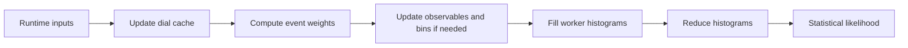

# CPU backend structure

The CPU backend executes a flat model with a persistent worker pool. The model
is read-only; response caches, observable state and results belong to the backend.
This page describes the execution architecture. See
[Reweight optimization](ReweightOptimization.md) for the benchmark evidence and
[Backends library](../BackendsLibrary.md) for the manager/backend interface.
Supported dial types and engine features are listed in the
[compatibility tables](../BackendsLibrary.md#compatibility).

## Model and ownership

`EngineLayout` builds an `EngineView` from the original GUNDAM objects and keeps
the bindings needed to exchange inputs and outputs. In normal manager execution,
`CpuBackend::buildShared()` retains a `shared_ptr<const EngineView>` to that
same model. The standalone `build()` API instead takes an owned snapshot.
Changing parameter values reuses the model; changing its structure requires a
rebuild.

The main arrays in `EngineView::propagation` are:

| Array | Content and indexing |
|---|---|
| `eventWeights` | One compact descriptor per result slot: double base weight, first dial-reference offset and dial count. Typically 24 bytes on a 64-bit build. |
| `eventDialIndices` | Flat 32-bit references to unique dials. Each event selects a contiguous range, retaining its original multiplication order. |
| `dials` | One descriptor per unique dial, with its type, input/payload ranges, response policy and external-weight references. |
| `dialInputs`, `dialPayloads` | Parameter indices and mirror settings, plus flat double numerical payloads such as spline coefficients. |
| `events`, `samples` | Observable/binning metadata, sample offsets and geometry. `EventView::resultIndex` connects each event to its weight slot. |
| Variable-response arrays | Initial observables and descriptors for overriding, multiplying or shifting them. |

Dial indices are assigned on first encounter while traversing events. Shared
dials reuse that index; their numerical payloads are not copied per occurrence.
The separate `eventWeights` array lets the hot product loop avoid reading the
larger observable/binning records. Common descriptors preserve semantics across
backends; they do not require device backends to use the CPU execution layout.

## Mutable storage

The CPU allocates response slots indexed by the same dial IDs, with eligibility
and validity flags. Single-input responses are cached; immutable `Shift`
responses are evaluated at build time. External weights and other uncached
responses remain available through the mixed evaluation kernel.

Parameter-to-dial lists identify candidates when parameters change. Equivalent
effective inputs share a prepared value and change flag, referenced by a 32-bit
group ID. This replaces the per-dial previous-input double array when it saves
memory; otherwise the backend keeps the per-dial representation. Neither path
duplicates spline payloads or response values.

`PropagationResult` retains event weights, histogram sums, squared sums and the
statistical likelihood. A new propagation overwrites these buffers and replaces
the current token. Callers must not treat an old token or a borrowed result view
as a snapshot of a previous evaluation.

Dynamic observables use a separate `EventState`: variables, bin assignments and
fractional contributions, together with revision/dependency tracking. Binning
indices and per-worker scratch support updates. Histogram workers each retain
their own sum and squared-sum arrays, including outside-bin slots per sample.
This is replication by histogram size, not by event or dial count.

## Propagation and distribution

`requestPropagation()` is synchronous. Stages run in order, with each worker job
joined before the following stage consumes its outputs. One backend instance
has one active input/result context; it is not a concurrent evaluation service.

The persistent pool is sized from the global CPU thread count at initialization.
Each stage uses its own partition:

| Stage | Work distribution |
|---|---|
| Dial cache | The calling thread finds changed parameters and prepares shared inputs. With sparse changes, workers split the candidate-index list; with at least half the dial descriptors affected, they scan contiguous descriptor ranges. With no candidates, the job is skipped. Response slots have one writer; group state is committed after the join. |
| Event weights | By default, workers claim two blocks per worker through an atomic counter. Each block is a contiguous event range, balanced at build time using `1 + dialCount`. An event is never split. Single-thread or very small models use fixed ranges. |
| Observables and binning | Separate event-range jobs update dependent variables, then bins/contributions. Revision checks skip unchanged state. Workers use private scratch and write disjoint event state. |
| Histograms | Workers scan fixed event ranges and accumulate into private histograms. The calling thread reduces bins in worker-index order after the join. Weight-block scheduling does not change this reduction order. |
| Statistical likelihood | The calling thread evaluates the configured bin likelihoods from the reduced sums and squared sums. |

All workers read the same model and response arrays. Weight jobs write disjoint
result slots, so the inner product loop needs no locks. Histogram updates need
no shared-bin atomics because their accumulators are private. The backend does
not pin workers or guarantee physical-core allocation; OS/Slurm affinity applies.

## Numerical and output contract

Build-time kernel selection distinguishes fully cached/mixed responses,
capped/uncapped weights and dynamic/fixed scheduling. Fully cached loops load
an index and its double response, then multiply in event dial order. The product
starts at one, the optional cap applies to that product, and the base weight is
multiplied last. There is no JIT compilation or float conversion.

An unchanged dial cache avoids response evaluation, but event products and
histograms are still recomputed. Observable/binning reuse is independent of
response-cache reuse and includes relevant external-buffer generations and
observable revisions.

The returned token identifies the latest completed result. CPU materialization
marks resident outputs available on the host; publishing them into original
GUNDAM event/histogram objects is handled by the manager when requested. The fit
can consume the statistical likelihood without copying all event weights back
to those objects on every call.

The implementation is split between `CpuBackend.cpp` (cache, weights,
histograms and orchestration), `CpuBackendBinning.cpp` (observable state),
`CpuWeightKernels.h` (product loops) and `CpuBackendProfiler.cpp` (diagnostics).
Diagnostic controls and probes do not define a different production model.
