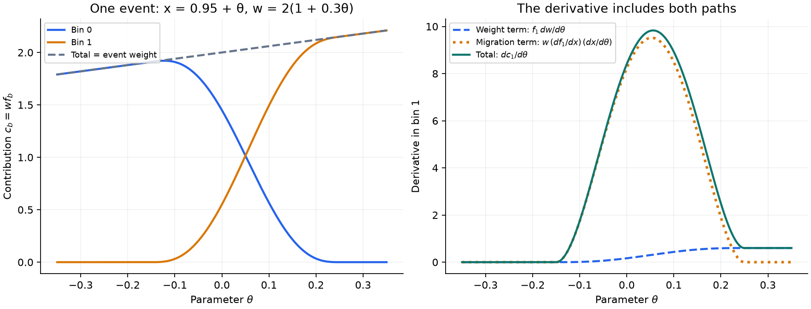
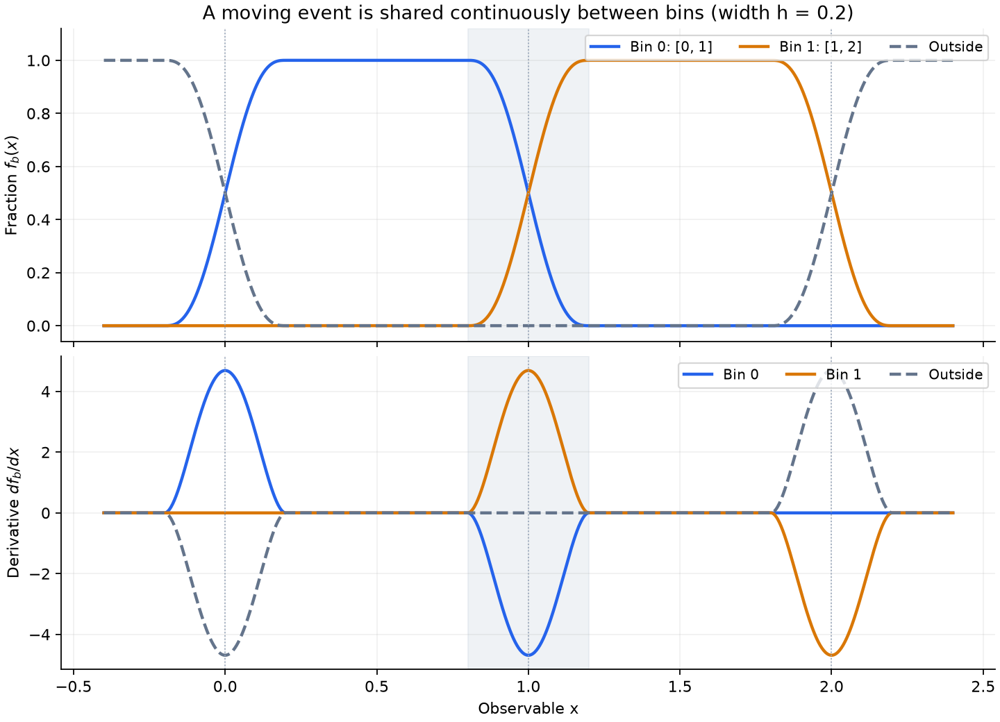
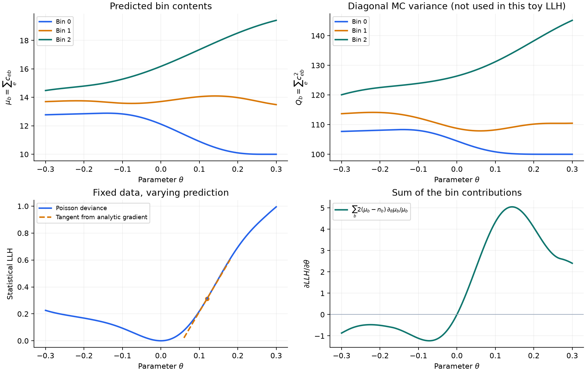

# Observable and bin-migration gradients

Analytic gradients can propagate through observable-response dials and the
existing smoothed binning response. This differentiates the **same smoothed
prediction and likelihood** used for value evaluation. It does not differentiate
an unsmoothed histogram or remove finite-MC fluctuations.

## Calculation

| Stage | Forward value | Derivative propagated |
| --- | --- | --- |
| Weight dials | Event weight `w_e` | `∂w_e/∂θ` |
| Observable dials | Current coordinate `x_ek` | `∂x_ek/∂θ` |
| Smoothed binning | Fraction `f_eb(x_e)` | `∂f_eb/∂x_ek` |
| Event → bin | Contribution `c_eb = w_e f_eb` | Weight term + migration term |
| Histogram | `μ_b = Σc_eb`, `Q_b = Σc_eb²` | `∂μ_b/∂θ`, `∂Q_b/∂θ` |
| Statistical LLH | LLH evaluated from `μ_b` and `σ_b = √Q_b` | Bin adjoints accumulated into `∂LLH/∂θ` |


For event `e`, let `w_e` be its weight, `x_e` its vector of current observables,
and `f_eb(x_e)` its fractional contribution to bin `b`. The bin contribution is

```text
c_eb = w_e * f_eb
∂c_eb/∂θ = f_eb * ∂w_e/∂θ + w_e * Σk (∂f_eb/∂x_ek) * (∂x_ek/∂θ)
```

| Contribution to `∂c_eb/∂θ` | Expression | Physical effect |
| --- | --- | --- |
| Weight | `f_eb ∂w_e/∂θ` | Changes the weight assigned to the event. |
| Migration | `w_e Σk (∂f_eb/∂x_ek)(∂x_ek/∂θ)` | Redistributes the event across bins as its coordinates move. |



The left panel follows a single event crossing the boundary at `x = 1`.
The right panel separates the derivative in bin 1: the migration term is localized
near the boundary, while the weight term remains after the event has crossed.

Observable responses use the existing composition:

```text
x = (override response or loaded reference) * product(multiply responses)
    + sum(add responses)
```

Writing `r` for the loaded reference or override response, `m_i` for multiply
responses, and `a_j` for add responses:

| Observable operation | Contribution to `∂x/∂θ` |
| --- | --- |
| Loaded reference | Zero: the reference is fixed. |
| Override response `r` | `(∂r/∂θ) Π_i m_i` |
| Multiply response `m_i` | `r (∂m_i/∂θ) Π_{j≠i} m_j` |
| Add response `a_j` | `∂a_j/∂θ` |

The derivative follows this composition, including each dial's response
supervisor and parameter mirrors. Prefix/suffix products handle zero responses
without division. Observable-response dials are excluded from the event weight
product; a parameter may independently affect both weights and observables.
The global event-weight cap affects weight derivatives, while observable
migration still contributes when the event weight is capped.

`BinningResponse` differentiates its existing compact-support cumulative kernel:

```text
F(u) = 0                                  if u <= -1
     = t³ * (10 - 15t + 6t²), t=(u+1)/2   if -1 < u < 1
     = 1                                  if u >= 1
F'(u) = 15 * t² * (1-t)²                   inside the support, zero outside
```

A one-dimensional fraction is `F((upper-x)/hUpper) - F((lower-x)/hLower)`.
Multidimensional fractions are products of these factors. Absolute widths and
`widthFraction` are supported; the latter produces fixed, potentially distinct
widths at each edge when the binning is built. These widths are not fit
parameters. Derivatives follow the value evaluator's clipping and small
roundoff correction to the total fraction.



The shaded band marks the transition around the shared edge at `x = 1`.
The two derivatives cancel there: probability is transferred between bins.
At the outer boundaries, the outside fraction completes the partition, so
`Σ_b f_b + f_outside = 1` and `Σ_b ∂f_b/∂x + ∂f_outside/∂x = 0`.

The histogram quantities remain:

```text
μ_b = Σe c_eb                     ∂μ_b = Σe ∂c_eb
Q_b = Σe c_eb²                    ∂Q_b = 2 Σe c_eb ∂c_eb
σ_b = sqrt(Q_b)
```

With `A_b = ∂LLH/∂μ_b` and `B_b = (∂LLH/∂σ_b)/σ_b`, each contribution has adjoint
`A_b + B_b*c_eb`. This supplies both weight and observable derivatives without
storing a dense event-by-parameter Jacobian. At zero MC uncertainty, the existing
zero-uncertainty convention is retained. Statistical likelihood classes are
unchanged, as are Gaussian penalties and fit-coordinate transformations.

### From histogram derivatives to the LLH

| Quantity | Derivative | Role |
| --- | --- | --- |
| `μ_b` | `Σ_e ∂c_eb/∂θ` | Variation of the predicted bin content. |
| `Q_b` | `2 Σ_e c_eb ∂c_eb/∂θ` | Variation of the diagonal MC variance. |
| `σ_b`, when positive | `(∂Q_b/∂θ)/(2σ_b)` | Input to LLHs that depend on MC uncertainty. |
| Statistical LLH | `Σ_b [A_b ∂μ_b/∂θ + (∂LLH/∂σ_b) ∂σ_b/∂θ]` | Sum of prediction and uncertainty contributions. |



This deterministic example uses three stationary reference events and three
moving events. The observed reference is fixed at `θ = 0`. The top panels show
both histogram moments; the bottom panels illustrate a **Poisson-only LLH** and
its analytic derivative. The tangent has the slope supplied by the gradient.
The plotted MC variance is shown for context and is **not used** by this toy
Poisson likelihood; the implementation also propagates its derivative for
supported MC-aware likelihoods.

## Requirements

Enable `useAnalyticGradient: true` as usual. A sample with dynamic binning must
have an enabled `binningResponse`. Every histogram axis modified by an
observable-response dial must appear in its smoothing variables with a valid
positive width. Validation rejects a moving hard axis even when other axes are
smoothed. Hard axes independent of the fit parameters may remain unchanged.
Observable targets absent from the histogram need no binning derivative.

```yaml
binningResponse:
  isEnabled: true
  variables:
    - name: X
      width: 0.2
```

All attached dials must support analytic derivatives. The implementation follows
existing event membership, dial associations, and observable composition; it
introduces no sample reassignment or new inter-observable dependency graph.
Event-formula inputs retain their existing bound-input semantics. Dependencies
introduced outside this propagation chain are not differentiated. Bin edges,
widths, and loaded reference values are fixed.

Events outside the nominal histogram can still contribute through the smoothing
support. Fractions are not renormalized into the retained bins: the outside
fraction accounts for the remainder. Only bins used by the existing LLH supply
adjoints. In particular, bins ignored at the prior remain subject to that LLH's
existing ignore policy. Observed data and the stored Asimov reference remain
fixed during parameter variations.

## Statistical and performance limitations

- The result is an analytic gradient of the finite-MC smoothed objective.
  Smoothing changes the prediction. Small widths can leave the migration
  derivative dominated by a few events near bin edges; large widths can introduce
  appreciable smoothing bias. No universal width or minimum MC occupancy is
  imposed automatically.
- Compact-support smoothing does not guarantee a finite likelihood. A bin with
  positive observed data can lose all MC support after migration. For example,
  Gaussian Barlow–Beeston with zero prediction and zero MC uncertainty then has
  infinite LLH and an undefined gradient. This remains an explicit error; no
  positive floor or zero-gradient replacement is introduced. Finite-difference
  regression fixtures include stationary MC support in each bin, with a separate
  check that the unsupported case is rejected.
- Splitting one event across bins introduces correlated MC fluctuations. The
  existing per-bin MC treatment is retained. Under independent Poisson
  resampling of MC events, `Cov(b,b') = Σe w_e² f_eb f_eb'`; its off-diagonal
  terms are not modeled by independent per-bin Barlow–Beeston nuisances.
- Hard dial limits, interpolation knots, and zero-uncertainty boundaries retain
  their existing piecewise conventions. Smoothing bin assignments does not
  make every upstream dial differentiable everywhere.
- Fraction derivatives and their observable adjoints are evaluated per event
  in the likelihood gradient pass. Weight derivatives retain their existing
  parallel reduction. This first implementation prioritizes consistency and
  does not cache fraction Jacobians or parallelize the migration adjoints.

## Validation

Added tests (not executed as part of this implementation):

- `unitTest_BinningGradient.cpp`: two-dimensional fractions, absolute and mixed
  relative widths, support and domain boundaries, outside-fraction conservation,
  and rejection of moving hard axes.
- `595NumericsObservableGradient.py`: full-likelihood finite differences with
  shared weight/observable parameters, add/multiply/override responses, response
  smoothing, normalized/eigen coordinates, capped weights, zero products,
  unchanged data, and one/four propagation threads.
- `590NumericsWeightGradient.py`: smoothed weight-only histograms and continued
  rejection of observable migration through hard bins.

Finite differences validate the implementation against its own objective.
Statistical validation additionally requires independent MC or bootstrap
replicas, width scans, and checks of fitted parameter bias and uncertainty
coverage. These studies are not supplied by the regression tests.

## Regenerating the figures

The figures are illustrative calculations using the same kernel equations;
they do not run GUNDAM or its regression tests. Install `numpy` and `matplotlib`
in your Python environment, then run from the repository root:

```bash
python3 docs/gradient/GenerateObservableGradientPlots.py
```

The script writes three PNG files to `docs/gradient/figures/`, independently of
the working directory. Use `--output-dir /path/to/figures` to choose another
output directory. No input dataset or ROOT installation is required.
